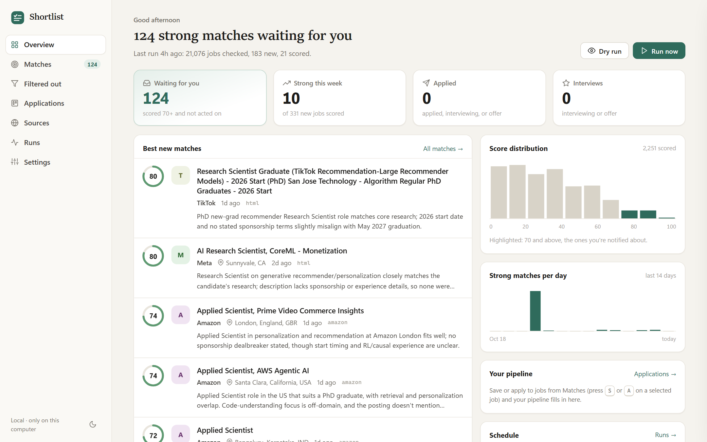
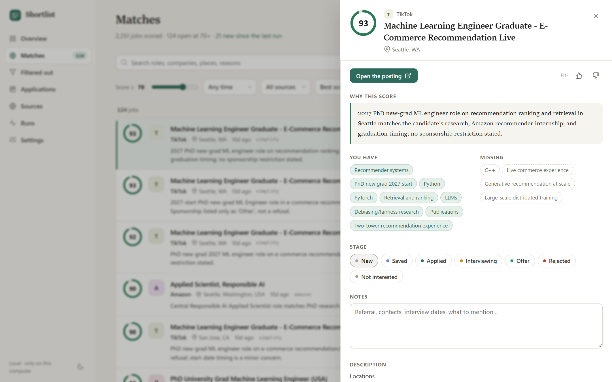
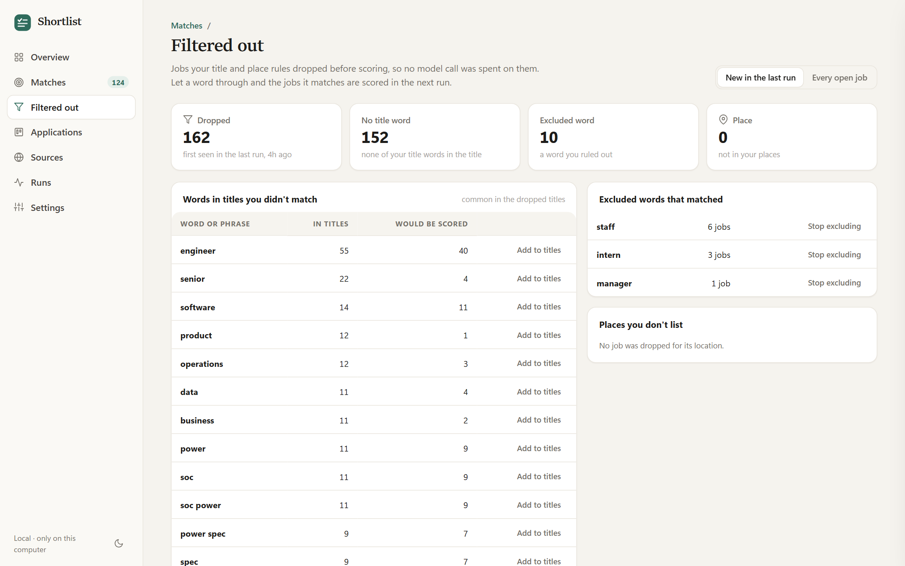
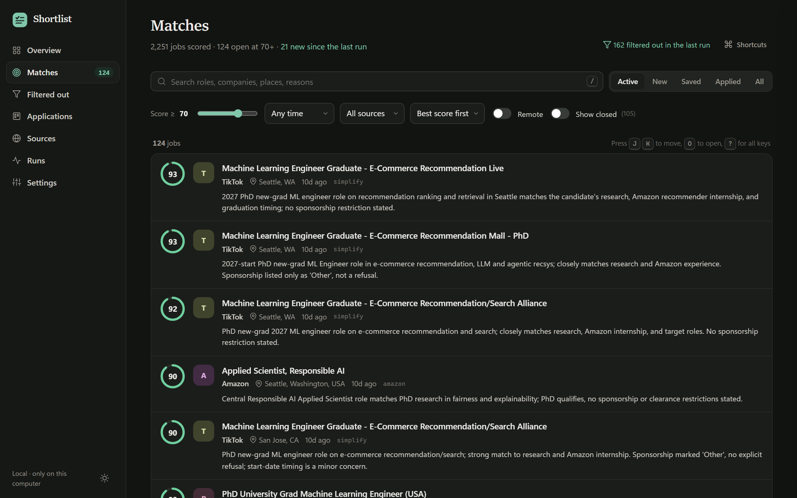

# Shortlist

Shortlist watches the job boards of the companies you care about, scores every new opening against your resume
with an LLM, and sends you the good ones. It runs on your own computer, needs no account or server, and comes
with a small web app for browsing matches and tracking your applications.

Each run it:

1. turns any new careers pages you listed into job boards it can read (once per site, then remembered),
2. fetches the new openings from those boards, the boards you listed, and job lists kept on GitHub,
3. drops obvious mismatches with cheap title and location rules, before any model call,
4. scores each **new** job against `resume.md` and your preferences (every job is scored at most once, ever),
5. sends a digest of the matches at or above your `min_score` by Telegram, or keeps them in the web app.

It only notifies. It never applies to anything.



- [Features](#features)
- [Quick start](#quick-start)
- [Commands](#commands)
- [Configuration](#configuration): [sources](#sources), [company packs](#company-packs), [filters](#filters),
  [preferences](#resume-and-preferences), [scoring backends](#scoring-backends),
  [scoring prompt](#scoring-prompt-and-re-scoring), [notifications](#notifications), [discovery](#discovery),
  [schedule](#running-on-a-schedule)
- [The web app](#the-web-app)
- [How it works](#how-it-works)
- [Responsible scraping](#responsible-scraping) and [privacy](#privacy-and-your-data)
- [Troubleshooting](#troubleshooting), [contributing](#contributing), [credits](#credits), [license](#license)

## Features

### Finding jobs

- **Job board APIs.** Reads the public JSON APIs of Greenhouse, Lever, Ashby, Workday, Workable, and Amazon Jobs,
  so a company on one of them costs one request per run, not a page crawl.
- **Careers-page discovery.** Give it any company's careers URL and it works out how to read it, cheapest first:
  a job board linked from the page; a board guessed from the company name (kept only if that board really belongs
  to the company); the page's schema.org `JobPosting` data; and only then a short, capped loop of model calls that
  proposes a board or a CSS recipe, each answer checked against the live site. The result is stored, so a site
  costs model calls once, and it is rediscovered automatically if it stops returning jobs.
- **HTML boards and JavaScript pages.** Pages without a known board are read with CSS-selector recipes (from
  discovery or written by you). A headless browser is used only for pages that load fine but are empty without
  JavaScript.
- **GitHub job lists.** Reads job lists kept on GitHub in the SimplifyJobs `listings.json` format, with filters for
  category, degree, sponsorship status, and age. Descriptions are fetched only for new listings that pass your
  filters.
- **Company packs.** Ready-made source lists to start from: about 3,500 companies in five packs by field (AI/ML and
  data, software, hardware, product, quant), about 100 AI labs, about 100 consumer-tech companies with ranking,
  search, and ads teams, and the SimplifyJobs new-grad list.
- **Only new roles.** Newest-first boards are read until the first page with nothing new, with a full read once a
  week; Greenhouse lists are fetched without descriptions, which are then fetched for new candidates only.

### Filtering and scoring

- **Cheap pre-filters.** Title keywords to include and exclude, allowed locations, and remote jobs, matched as whole
  words ("ml" matches "AI/ML" but not "HTML"). Most jobs never reach a model.
- **Resume-aware scoring.** Each job gets a 0-100 score with matched skills, missing skills, dealbreakers, and a
  one-line reason, judged against your resume and a free-text description of what you want.
- **Consistent scores.** Jobs that score near or above your threshold are scored again on their own, so a score
  doesn't depend on which other jobs shared the prompt.
- **Learns from your ratings.** Jobs you rate (thumbs up or down), apply to, or mark not interested are shown to the
  scorer as examples of what you want; Settings shows how often the scores agree with you.
- **Filtered out, explained.** A page lists the jobs your rules dropped and why, the common words in those titles,
  and how many jobs each word would let through, with one click to add it.
- **Closed postings marked.** A job its board stopped listing is marked closed and hidden from Matches unless you
  ask for it.
- **Your choice of model.** The Claude Code CLI or the OpenAI Codex CLI (your subscription or login, no API key),
  the Anthropic API, or the OpenAI API.
- **Duplicates folded.** Postings of exactly the same role in several cities are scored once and listed together.
- **Cost controls.** Batches of jobs per call, a cap on jobs scored per run, and caps on discovery calls per site and
  per run. Failed batches are retried next run; nothing is scored twice.

### Notifications

- **Telegram:** a message from your own bot. Long digests are split to fit Telegram's message size. A match is
  sent once; if sending fails, it goes out with the next run.
- **Or none:** leave notifications off and use the web app.

### Web app

- **Overview and Matches:** the strong matches waiting for you, the best new ones, and every scored job with search,
  filters, keyboard shortcuts, and a detail panel per job.
- **Filtered out:** what your title and place rules dropped, and which words would let more jobs through.
- **Applications:** a board of stages from saved to offer, with notes, applied dates, and CSV export.
- **Sources and Runs:** what each careers page was discovered as, every board's health, and runs with a live log.
- **Settings:** filters, preferences, the scoring model and prompt, re-scoring, notifications, packs, schedule, and
  your resume.

### Running it

- **Guided setup:** `python install.py` creates the environment and asks a few questions; `python -m shortlist
  check` tells you what is missing, with one small test call to your model.
- **Scheduling:** runs at logon and then at most N times a day, N hours apart (Windows Task Scheduler script
  included; cron on macOS and Linux). Scheduled and manual runs never overlap.
- **Polite by default:** respects robots.txt, sends about one request per second per site, identifies itself, and
  never works around bot protection. See [Responsible scraping](#responsible-scraping).

## Quick start

You need Python 3.11 or newer and Git. For scoring you need one of: [Claude Code](https://code.claude.com/docs)
logged in with a Claude subscription, the OpenAI Codex CLI signed in, an Anthropic API key, or an OpenAI API
key.

```bash
git clone https://github.com/navkar98/shortlist.git
cd shortlist
python install.py          # Windows: py -3.11 install.py if `python` is older
```

`install.py` creates a virtual environment in `.venv`, installs the dependencies, offers to install the headless
browser for JavaScript-only careers pages (about 150 MB, optional), and then runs the setup wizard. The wizard asks
what roles and places you want, which company packs to follow, which model to score with, and where to send
matches, and writes `config.yaml`, `resume.md`, and `.env` (for keys and tokens). It never overwrites files you
already have, so it is safe to run again.

Then, with the environment activated (`.venv\Scripts\activate` on Windows, `source .venv/bin/activate` elsewhere):

```bash
python -m shortlist check                      # what's missing? (makes one small test call to your model)
python -m shortlist run --dry-run --limit 20   # first run: fetch, score 20 jobs, print the digest
python -m shortlist web                        # browse matches at http://127.0.0.1:8765
```

Put your resume in `resume.md` as plain text or Markdown before the first real run (the web app's Settings page
has an editor). The first run fetches every open job once and can find hundreds of candidates; `--limit` spreads
the scoring over several runs.

## Commands

| Command | What it does |
|---|---|
| `python -m shortlist init` | Setup wizard: writes `config.yaml`, `resume.md`, and `.env` (`--yes` accepts every default) |
| `python -m shortlist check` | Checks the config, resume, database, scoring backend, notifications, and browser |
| `python -m shortlist check --send-test` | ...and sends a test message on each notification channel |
| `python -m shortlist run` | Discover, fetch, filter, score new jobs, send the digest |
| `python -m shortlist run --dry-run` | Same, but print the digest instead of sending it (jobs are still scored and stored) |
| `python -m shortlist run --limit N` | Score at most N new roles this run |
| `python -m shortlist run --if-due` | Run only if the `schedule` limits allow it now (what the scheduled task calls) |
| `python -m shortlist rescore` | Score open jobs again, each on its own, after a change to your resume, preferences, or prompt: those scoring `min_score` - 15 or more that were scored with an earlier version |
| `python -m shortlist rescore --from N [--all] [--limit N]` | From score N up; `--all` also takes jobs already scored with the current version; at most `--limit` jobs |
| `python -m shortlist discover` | Turn new or broken careers pages into boards now, without fetching jobs |
| `python -m shortlist discover --site NAME` | Rediscover one careers page from scratch |
| `python -m shortlist sites [--forget NAME]` | Show what each careers page was discovered as; forget one so it is rediscovered |
| `python -m shortlist web` | Open the web app (`--port`, `--no-browser`) |

Every command takes `--config PATH` (default `./config.yaml`) and `--log-file PATH` (append the log to a file).

## Configuration

Everything lives in `config.yaml` (your copy of [config.example.yaml](config.example.yaml), whose comments explain
each setting), `resume.md`, and `.env` (secrets; see [.env.example](.env.example)). Most of it can also be edited on
the web app's Settings page.

### Sources

```yaml
packs: [ai-labs]               # ready-made lists, see below
companies:                     # company job boards, one "ats:slug" each
  - greenhouse:airbnb
  - workday:nvidia.wd5/NVIDIAExternalCareerSite
career_pages:                  # careers pages whose board you don't know: discovery figures them out
  - {name: "Acme AI", url: "https://acme.ai/careers"}
```

| Entry | Where the slug comes from |
|---|---|
| `greenhouse:<slug>` | `boards.greenhouse.io/<slug>` or `job-boards.greenhouse.io/<slug>` |
| `lever:<slug>` | `jobs.lever.co/<slug>` |
| `ashby:<slug>` | `jobs.ashbyhq.com/<slug>` |
| `workday:<tenant>.wd<N>/<site>` | `https://<tenant>.wd<N>.myworkdayjobs.com/<site>` |
| `workable:<account>` | `apply.workable.com/<account>` |
| `amazon:<search words>` | a search on amazon.jobs; the newest 500 matches |

When you don't know a company's board, add its careers page to `career_pages` (or on the web app's Sources page)
and let [discovery](#discovery) find it.

`html_boards` holds careers pages read with CSS selectors, for the rare page discovery can't handle:

```yaml
html_boards:
  - {name: Waymo, url: "https://careers.withwaymo.com/jobs/search?page=1", jobs: ".job-search-results-card",
     link: ".job-search-results-card-title a", location: ".job-component-location", next_page: 'a[rel="next"]'}
```

`jobs` selects one element per job; `title`, `link`, and `location` are looked up inside it; `next_page` is
followed up to `max_pages`. Without `jobs`, the page's schema.org JobPosting data is read. `render: true` loads the
page in the headless browser first.

`github_listings` reads job lists kept on GitHub in the SimplifyJobs format:

```yaml
github_listings:
  - name: SimplifyJobs new-grad
    url: https://raw.githubusercontent.com/SimplifyJobs/New-Grad-Positions/dev/.github/scripts/listings.json
    keep_categories: [AI/ML/Data]        # keep a listing if its category is here...
    keep_degrees: [PhD]                  # ...or it names one of these degrees (both empty: keep all)
    drop_sponsorship: [U.S. Citizenship is Required, Does Not Offer Sponsorship]
    max_age_days: 120
```

### Company packs

Packs are source lists in the [packs/](packs) folder that your config adds with `packs: [name, ...]`. Your own
entries come first; a board or URL that is already in your config is not added twice.

| Pack | What's in it |
|---|---|
| `ai-labs` | About 100 AI labs and AI-first companies (careers pages for discovery), plus machine-learning searches on NVIDIA, Hugging Face, Mila, Amazon, Meta, and Snap |
| `consumer-tech` | About 100 consumer-tech, marketplace, media, and ad-tech companies with recommendation, ranking, search, and ads teams (Greenhouse, Lever, Ashby, Workday) |
| `new-grad` | The SimplifyJobs New-Grad-Positions list on GitHub |
| `ai-ml-data` | 2,124 companies that posted AI, machine learning, or data roles for new grads or interns |
| `software` | 1,974 companies that posted software engineering roles |
| `hardware` | 688 companies that posted hardware engineering roles |
| `product` | 618 companies that posted product management roles |
| `quant` | 317 companies that posted quantitative finance roles |

The five field packs hold every company board linked from the SimplifyJobs new-grad and internship lists that
Shortlist can read (Greenhouse, Lever, Ashby, Workday, Workable), grouped by the roles each company posted, and each
board listed open jobs when the pack was built (2026-11-01). Workday boards with more than 2,000 open jobs (mostly
store and retail jobs) are left out; add one to `companies` yourself if you want it. A pack's file says how long a
run takes with it.

**Big packs make runs longer.** Every Greenhouse board is read from one Greenhouse host, every Lever board from one
Lever host, and so on, at about one request a second, so a run takes about as long as the busiest host: with
`ai-ml-data`, about 16 minutes. The first run reads each Workday board to the end (about 2 hours for `ai-ml-data`),
and each board is read to the end again once a week; runs in between read only the newest page. Scheduled runs
happen in the background, but pick the packs of your field rather than all of them.

A pack can also be a file of your own: `packs: [my-companies.yaml]` (relative to `config.yaml`, same format as the
bundled ones). New packs are welcome as pull requests; see [CONTRIBUTING.md](CONTRIBUTING.md).

### Filters

```yaml
filters:
  title_include: [machine learning, data scientist, research engineer]   # a title must contain one of these
  title_exclude: [intern, staff, principal, manager]                     # and none of these
  locations: [united states, us, canada, remote]                         # the location must mention one
  allow_remote: true        # also keep remote jobs whose location names no place ("Remote", "Anywhere")
```

Matching ignores case and works on whole words and phrases. These rules run before any model call, so they decide
most of your cost. An empty `title_include` sends every title to the scorer.

### Resume and preferences

`resume.md` is your resume as plain text or Markdown. `preferences` in `config.yaml` is free text the scorer reads
next to it: the roles you want, seniority, domains, locations, and dealbreakers. Be specific: "needs visa
sponsorship; a posting that rules it out is a dealbreaker" or "no roles requiring a security clearance" are exactly
the kind of thing the scorer applies. A job that hits a dealbreaker scores 20 or lower.

`min_score` (default 70) is the threshold for the digest. Rough scale: 85+ apply now, 70-84 strong fit, 40-69
partial fit.

### Scoring backends

| `scoring.backend` | What you need | `model` |
|---|---|---|
| `claude_cli` (default) | [Claude Code](https://code.claude.com/docs) logged in with a Claude subscription | `sonnet` (default), `opus`, `haiku`, or a full model name |
| `codex_cli` | The OpenAI Codex CLI (npm package `@openai/codex`) signed in with `codex login` | empty: Codex's own default; or a model name |
| `anthropic_api` | `ANTHROPIC_API_KEY` in `.env` | `claude-opus-5-5` (default), `claude-sonnet-5-5`, `claude-haiku-5-5` |
| `openai_api` | `OPENAI_API_KEY` in `.env` | required, e.g. `gpt-5.4-mini` |

```yaml
scoring:
  backend: openai_api
  model: gpt-5.4-mini
  max_jobs_per_run: 100                   # cap on jobs scored per run (0: no cap)
  batch_size: 12                          # jobs per model call
```

- **Claude Code CLI.** Shortlist runs `claude -p` with a JSON schema, no tools, and no session history, in an empty
  folder (`scoring.workdir`, default `~/.shortlist/scorer_workdir`) outside the repo, because Claude Code reads
  `CLAUDE.md` files from its working folder and every folder above it. `ANTHROPIC_API_KEY` is removed from its
  environment so it always uses your subscription. Set `claude_path` to the absolute path of `claude` if a scheduled
  task can't find it. For unattended runs, `claude setup-token` prints a long-lived token: put it in `.env` as
  `CLAUDE_CODE_OAUTH_TOKEN`.
- **Codex CLI.** Shortlist runs `codex exec` with an output schema, a read-only sandbox, and no saved session, in
  the same empty `workdir` (Codex reads `AGENTS.md` from its working folder). `OPENAI_API_KEY` and `CODEX_API_KEY`
  are removed from its environment so it uses your login; for API billing, use `openai_api`. `effort` sets
  its reasoning effort. `codex_path: codex` also finds the `codex.cmd` that npm installs on Windows.
- **Anthropic API.** Uses the Messages API with structured outputs, so answers always match the schema. `effort:
  low` lowers cost on the models that support it. On the newest models, a declined request is retried on a fallback
  model automatically (server-side refusal fallback).
- **OpenAI API.** Uses `/chat/completions` with a strict JSON-schema response format, so answers match the
  schema.
- **Cost.** A batch of 12 jobs is up to about 30k input tokens (descriptions are capped at 8,000 characters each)
  and 1-2k output tokens. Jobs scoring near or above `min_score` are scored once more on their own (about one job
  in six; `recheck_alone: false` turns it off). The first run on a large source list can score hundreds of jobs,
  later runs only new ones. With a pay-per-use API, set `max_jobs_per_run` and tight filters.

Discovery's model calls go through the same backend (`discovery.model` can name a different model).

### Scoring prompt and re-scoring

The instructions the model reads before your resume, preferences, rated jobs, and the jobs are built in, and you can
replace them: on the web app's Settings page, which also shows the whole prompt for one job, or as
`scoring.instructions` in `config.yaml`. Empty means the built-in prompt, which keeps up with improvements to
Shortlist. Whatever the instructions say, the answer's shape (score, skills, dealbreakers, reason) is fixed by a
JSON schema.

Each score records the resume, preferences, and prompt it was made with (spacing and line breaks don't count).
After you change one, Settings shows how many open jobs were scored with an earlier version and re-scores them in
the background; `python -m shortlist rescore` does the same. Each job is scored on its own, with the jobs you rated as
examples (about 5 seconds a job with `claude_cli`), and jobs stored without a description get it read again. By
default it takes open jobs scoring `min_score` - 15 or more, the ones that can cross the line. A job that rises to
`min_score` and was never sent goes out with the next digest.

### Notifications

```yaml
notify: [telegram]          # [] = web app only
```

The bot's secrets go in `.env` (the wizard writes them for you). `python -m shortlist check --send-test` sends a
test message.

| Channel | `.env` | How to get it |
|---|---|---|
| Telegram | `TELEGRAM_BOT_TOKEN`, `TELEGRAM_CHAT_ID` | Message [@BotFather](https://t.me/BotFather), send `/newbot`, and copy the token. Send your new bot any message, then open `https://api.telegram.org/bot<TOKEN>/getUpdates`: your chat id is `result[0].message.chat.id`. |

Each digest lists score, title, company, location, the one-line reason, and the link. Digests longer than
Telegram's message limit (4096 characters) are split into numbered parts; a part that fails to send is sent with the
next run.

### Discovery

Every run turns new careers pages in `career_pages` into something readable, and stores the result in the database
(`python -m shortlist sites` lists them). A site costs model calls only when it is new, or when its board returned no
jobs for `rediscover_after_empty_runs` runs in a row (at most weekly). Sites that can't be read are retried monthly.

```yaml
discovery:
  model: ""                       # empty: same as scoring.model
  max_agent_calls_per_site: 5     # 0 = no model calls: linked boards, guessed boards, and JobPosting data only
  max_agent_calls_per_run: 40     # sites left over are discovered in later runs
  rediscover_after_empty_runs: 2
```

Why 5: measured on the 100 careers pages of the `ai-labs` pack (2026-10-21) with up to 10 calls per site, 63 sites
needed no model call (43 boards linked from the page, 20 found from the company name), the agent solved 29 of the 35
it was asked about, and 8 stayed unsupported (blocked by robots.txt, unreadable, or job cards without links).

| calls allowed per site | 1 | 2 | 3 | 4 | 5 | 10 |
|---|---|---|---|---|---|---|
| sites the agent solved | 11 | 22 | 24 | 27 | 29 | 29 |
| total calls spent | 35 | 59 | 69 | 76 | 80 | 87 |

Every solved site needed 5 calls or fewer; calls beyond 5 only went to sites that were never solved. The whole first
discovery of those 100 sites cost about 80 calls, once.

### Running on a schedule

Scheduled runs call `python -m shortlist run --if-due`, which runs only when the limits in `config.yaml` allow it
and otherwise logs `not due` and exits:

```yaml
schedule:
  max_runs_per_day: 2          # at most this many runs per calendar day
  min_hours_between_runs: 6    # and at least this long after the previous run
```

A run that fetched nothing (say, no network yet right after logon) or failed to send doesn't count, so the next check
tries again. Manual runs are never limited.

**Windows.** The wizard can register the task for you, or:

```powershell
powershell -ExecutionPolicy Bypass -File scripts\schedule_windows.ps1                        # install or update
powershell -ExecutionPolicy Bypass -File scripts\schedule_windows.ps1 -CheckEveryMinutes 30  # check more often
powershell -ExecutionPolicy Bypass -File scripts\schedule_windows.ps1 -Remove                # remove
```

The task starts at logon and checks every hour while you are logged on, so with the defaults you get a run soon
after you start the computer and another one 6+ hours later. It runs without a window, at normal priority, on
battery too, and only with a network. Output goes to `shortlist.log`. Try it with
`Start-ScheduledTask -TaskName Shortlist`.

**macOS and Linux.** Add to `crontab -e` (absolute paths; cron has a minimal `PATH`):

```cron
@reboot   cd /home/you/shortlist && .venv/bin/python -m shortlist run --if-due --log-file shortlist.log
0 * * * * cd /home/you/shortlist && .venv/bin/python -m shortlist run --if-due --log-file shortlist.log
```

With `claude_cli`, also set `scoring.claude_path` to the output of `which claude`.

## The web app

```bash
python -m shortlist web       # opens http://127.0.0.1:8765
```



<p>
</p>

- **Overview:** how many strong matches are waiting, this week's numbers, the best new matches, the score
  distribution, strong matches per day, your application pipeline, and when the last run happened.
- **Matches:** every scored job, best first, as a list with a score ring, company, place, age, and the one-line
  reason. Search and filter by stage, minimum score, time, source, and remote; 50 at a time with "Show more". Hover
  a job (or select it with the keyboard) for quick actions: save, applied, good or poor fit, not interested. Its
  title opens the detail panel: why it scored that way, the skills you have and miss, dealbreakers, the stage, your
  notes (saved as you type), and the full description. Closed postings stay hidden unless you ask for them.
- **Filtered out:** the jobs your title and place rules dropped (new in the last run, or among every open job) and
  why. The common words in the dropped titles show how many jobs each would let through, next to the excluded words
  that matched and the places you don't list; one click changes the filter, and a word that would send more than
  100 jobs to the scorer asks first.
- **Applications:** a board with a column per stage. Drag a card to move it (or use its menu); moving a job to
  applied records the date. Rejected and not interested sit in a closed row below. CSV export.
- **Sources:** what each careers page was discovered as, its model calls, and whether it still returns jobs; add a
  careers page (discovered right away) or rediscover one. Every job board's health, with a filter box.
- **Runs:** buttons for discovery, a dry run, or a real run, with a live log; a chart of new and scored jobs per run;
  and the history.
- **Settings:** minimum score, preferences, filters (edited as tags), scoring backend and model, how often the
  scores agree with your ratings, the scoring prompt (with the whole prompt for one job), re-scoring, notification
  channels (and whether their secrets are set; values are never shown), packs, schedule, and your resume. Saving
  rewrites only the sections you changed and keeps the previous file as `config.yaml.bak`.

Keyboard on Matches: <kbd>J</kbd>/<kbd>K</kbd> move, <kbd>O</kbd> opens, <kbd>S</kbd> saves, <kbd>A</kbd> marks
applied, <kbd>G</kbd>/<kbd>B</kbd> rate the fit, <kbd>X</kbd> hides, <kbd>/</kbd> searches, <kbd>?</kbd> lists
them all. Light and dark follow your system; the moon or sun button in the sidebar switches.

The app is for you on your computer: it listens on 127.0.0.1 and has no login. It answers only requests addressed to
localhost (which blocks DNS rebinding), and every change needs a token from the page, so other websites open in your
browser cannot use it. `--host 0.0.0.0` makes it reachable from your network; do that only on a network you trust.

## How it works

```
careers pages ──discovery──▶ boards ─┐
company boards ──────────────────────┼──▶ new jobs ──▶ pre-filter ──▶ descriptions ──▶ score ──▶ digest
GitHub job lists ────────────────────┘     (SQLite)     (no model)    (new ones only)   (batches)  (channels)
```

- **Storage.** `shortlist.db` (SQLite, next to `config.yaml`) keeps every job once per `(source, board, job id)`
  with its score, when it was first and last seen, and when it was sent. Delete it to start over.
- **Only new roles.** Paged boards (Workday, Amazon, HTML boards) list newest first, so a run stops at the first page
  whose jobs all need no more work (already scored, or rejected by your filters); each board is read to the end once
  a week. A match is sent only if its board listed it in the last 48 hours.
- **Descriptions.** Board APIs include them, except Greenhouse lists (fetched without them, about 12x smaller) and
  Workday; those, and GitHub listings, get their description fetched for new candidates only: from the board's API
  for Greenhouse and Lever links, otherwise from the page's schema.org JobPosting data or readable text. When none
  can be read, the job is scored on its title and listing, and the reason says so.
- **Scoring.** Batches of `batch_size` jobs go to the model with your resume, your preferences, and the jobs you
  rated, and every answer is validated against a JSON schema. A job missing from an answer is retried alone once; a
  batch that fails is logged and retried next run. One failing company, page, or batch never stops a run.
- **Re-checking alone.** In a batch, a job's score moves with the other jobs in it and their order (measured on 12
  jobs scored in two orders: 12 points apart on average, up to 23), while the same job scored on its own gets the
  same score each time. So every job scoring within 15 points of `min_score`, or above it, is scored again alone and
  that score is kept (`scoring.recheck_alone`). In practice that is about one job in six.
- **Your ratings.** Up to `scoring.feedback_examples` jobs you judged go into the prompt: a thumbs up or applying
  counts as a good fit, a thumbs down or "not interested" as a poor one. Ratings that disagree with the score come
  first, since they show where scoring went wrong.
- **Closed postings.** Greenhouse, Lever, Ashby, Workable, and GitHub lists show every open job each run, so a job
  missing from a read of its board is closed; Workday boards are read to the end weekly, so a job unseen for 8 days
  is. Amazon searches (newest 500) and HTML pages (limited pages) can drop open jobs, so they are never marked.
- **Locking.** A run, a discovery, and the scheduled task take the same lock, so they never overlap.

## Responsible scraping

Shortlist reads public job listings for one person, and it is built to be a good citizen of the sites it visits:

- **robots.txt** is respected for every request ([RFC 9309](https://www.rfc-editor.org/rfc/rfc9309)): a disallowed
  page is skipped and logged. `ignore_robots: true` exists per HTML board, for you to set after checking a site's
  terms; Shortlist never sets it itself.
- **About one request per second per site**, with timeouts and a few requests at a time overall.
- **It identifies itself** with the User-Agent `shortlist/0.1 (+https://github.com/navkar98/shortlist; ...)`, so site
  owners can see what it is and block it in robots.txt if they want (`User-agent: shortlist`).
- **No working around blocks.** A site that answers 403, 429, or a bot challenge is skipped. The headless browser is
  used only for pages that load fine but need JavaScript to show their content.
- **Public APIs first.** Job board APIs are designed to be read by programs and are far lighter than page crawls.
- **Excluded on purpose:** LinkedIn, Indeed, Glassdoor, and search engines, whose terms forbid automated access.

Check the terms of any site you add yourself. You are responsible for how you use this tool.

## Privacy and your data

- Everything is stored locally: `config.yaml`, `resume.md`, `.env`, and `shortlist.db` stay on your computer, and
  all four are in `.gitignore`.
- **Your resume and preferences go to the model you choose**, with each batch of jobs: to Anthropic through Claude
  Code or the API, or to OpenAI through Codex or the API. Their data policies apply.
- **Digests go to Telegram** when you turn it on.
- Job sites see ordinary requests for their public listings. Shortlist sends no telemetry and has no server.
- Secrets are read from the environment or `.env` and never logged; error messages leave out the bot token.

## Troubleshooting

- **Start with `python -m shortlist check`.** It names what's missing.
- **`... must be set (in the environment or .env) to notify by ...`**: add the Telegram secrets to `.env`, remove
  `telegram` from `notify`, or use `--dry-run`.
- **`claude ... not found` or `FileNotFoundError` in a batch line**: set `scoring.claude_path` to the absolute path
  (`where claude` on Windows, `which claude` elsewhere).
- **Claude Code bills your API account instead of your subscription**: `ANTHROPIC_AUTH_TOKEN` outranks a
  subscription login; don't set it. (Shortlist already removes `ANTHROPIC_API_KEY` for the CLI.)
- **A careers page shows `unsupported`**: `python -m shortlist sites` gives the reason (robots.txt, 403, or nothing
  readable). If you know its board, add it to `companies` instead.
- **JavaScript-only pages are skipped**: install the browser with `python -m playwright install chromium` (on Linux,
  also `python -m playwright install-deps chromium`, which uses sudo).
- **`WinError 206` or "filename too long" while installing on Windows**: the folder path is too long for one of
  Playwright's files. Clone into a shorter folder (such as `C:\shortlist`), or enable Windows long paths.
- **The first run takes long**: every open job that passes the filters is scored once. Use `--limit` or
  `scoring.max_jobs_per_run` to spread it out.

## Contributing

Bug reports, company packs, new job board adapters, and backends are welcome. [CONTRIBUTING.md](CONTRIBUTING.md)
explains the setup, the tests, and the few rules that keep Shortlist reliable and polite.

## Credits

Shortlist was vibe-coded with [Claude Code](https://claude.com/claude-code), Anthropic's coding agent. Claude wrote
the code, tests, and docs in conversation; I decided what to build, tried each change on my own job search, and
said what to fix. [CLAUDE.md](CLAUDE.md) is the brief it worked from: the project's rules and the facts it verified
along the way (API responses, CLI flags, measurements). If you work on Shortlist with Claude Code, it reads that file
too.

Shortlist also ships [htmx](https://htmx.org) (Zero-Clause BSD) and icons adapted from
[Feather](https://feathericons.com) (MIT).

## License

[MIT](LICENSE)
